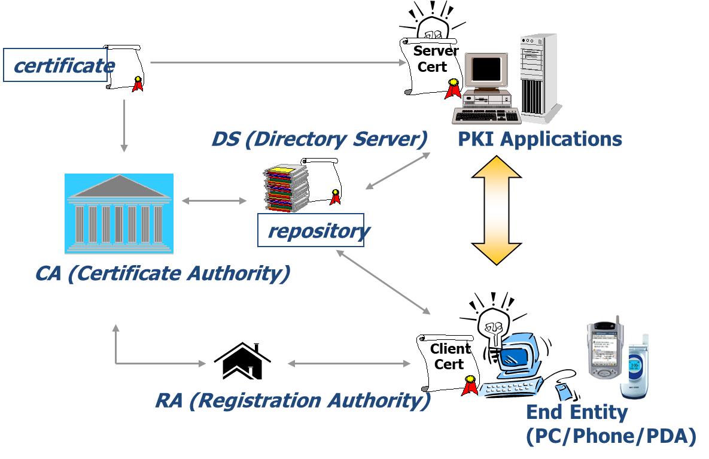

# Public Key Infrastructure (PKI): Concepts

*PKI / General Information · April 27, 2023*

The term **PKI** appears in many fields. After working with it for a long time, I have come to think of PKI as a component that supports many different systems. It is rarely used on its own, but it turns up in many places. This article offers a brief overview of the concept.

## 1. What is PKI?

**Public Key Infrastructure (PKI)** is a system of capabilities, policies, and services that uses public-key cryptography to support authentication of users and devices.

There is no single universally fixed list of PKI components. A typical PKI includes **Certificate Authorities (CAs)** and **Registration Authorities (RAs)**, and uses certificates issued by a CA to authenticate users or devices. The certificate and its issuing authority distinguish PKI from a generic public-key cryptography system.

## 2. PKI components

The diagram below shows common PKI components and their relationships.

### 2.1 Certificate Authority (CA)

- Issues and distributes certificates for entities such as other CAs and end entities.
- Revokes certificates at the request of an RA or a user, according to the PKI's procedures.
- Publishes Certificate Revocation Lists (CRLs) in a public location, often a directory service (DS).

### 2.2 Registration Authority (RA)

- Identifies users and asks a CA to register them or issue certificates.
- Can request certificate revocation and provide certificate status lookup services.

### 2.3 Directory Server (DS)

- Stores and publicly publishes certificates and CRLs so they can be retrieved by others.
- Often uses LDAP (Lightweight Directory Access Protocol).
- May also publish information through web or FTP services.

### 2.4 End Entity (EE)

- A user, device, or other subject that uses a certificate issued by a CA.
- May create digital signatures or verify signatures, depending on its role.

## 3. Additional PKI services

A PKI can operate with its core components, but additional services can provide useful security and status information.

### 3.1 Online Certificate Status Protocol (OCSP)

- CRLs are published periodically, so they may not reflect a certificate's status immediately.
- A CRL can also be large and require significant network traffic. OCSP can return status information for an individual certificate.
- OCSP is commonly used as an alternative or complement to retrieving a full CRL. The actual freshness of a response depends on the service and its configuration.

### 3.2 Time-Stamping Authority (TSA)

- A TSA provides trusted evidence that data existed at a particular time.
- It responds to a time-stamp request with a signed token that binds a time to a digest of the submitted data.
- Time-stamp services can also provide ordering information, such as a sequence number, when the service is designed to do so.

## 4. PKI use cases

PKI supports many kinds of systems. Common examples include:

### 4.1 Web security

- TLS certificates are used to authenticate servers in HTTPS connections and support secure communication.

### 4.2 Document encryption and signatures

- Certificates can be used in workflows for encrypting documents such as PDFs and for creating or verifying digital signatures.

### 4.3 Email authentication and encryption

- S/MIME uses certificates for signing and encrypting email.
- OpenPGP (often called PGP) is also based on public-key cryptography, but its key distribution and trust models are not inherently based on the X.509 certificate hierarchy used by many PKI systems.

### 4.4 User authentication

- Certificate-based technologies are used for user authentication, including in some VPN deployments.

### 4.5 Online banking

- In South Korea, PKI systems have been used in various online banking services to authenticate users.

## Conclusion

PKI brings together many technologies: each component and each certificate-related process has its own details. This article has covered only the basic concepts, as a starting point for understanding the wider system.

**Tags:** DS · EE · certificates · CA · RA · PKI · Public Key Infrastructure · End Entity
