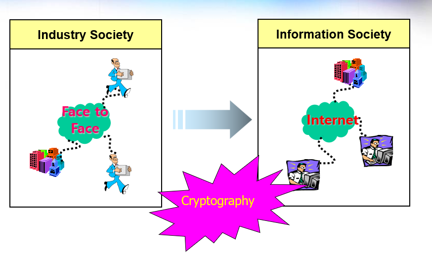

# A Story About Digital Signatures and Certificates

*PKI / General Information · May 3, 2023*

Digital signatures and certificates are technical topics in public key infrastructure (PKI). Here is a plain-language explanation.

## The seal certificate analogy

A useful real-world analogy for a digital signature and a certificate is a **certificate of registered seal**. In a paper-based process, someone signs a document with a seal, and the certificate helps others confirm that the seal is valid and belongs to that person.

In the offline world, people handle identity checks and documents in person. As these processes move online, they are digitized: a person signs data with a **private key**, and another party verifies the signature with the corresponding **public key**. A certificate is a digitally signed document that vouches for the relationship between that public key and its subject.

The analogy is not exact, but it helps explain the roles. A seal is applied to a physical document. A digital signature is computed over digital data, so changing the data after signing causes signature verification to fail. In a paper process, people may compare a copy with the signed original to check whether the document was altered.

## Security needs when moving online

When paper-based processes move online, we need to consider several security properties:

1. **Confidentiality** — Only authorized people should be able to read the document.
2. **Integrity** — Changes to the digital data should be detectable.
3. **Authenticity** — The recipient should be able to verify who signed the document.
4. **Non-repudiation** — The signature can provide evidence that the holder of the signing key signed the data, making a later denial harder.

In an offline process, identity documents can help establish who is present; an envelope can limit who sees the contents; and comparing copies can reveal changes. A person also signs the document directly. Online, cryptography helps address these needs: **digital signatures** provide integrity checks and support signer authentication and non-repudiation, while **encryption** protects confidentiality.

## Why certificates matter

Anyone can generate a key pair for creating digital signatures. But how can a verifier know that a particular public key belongs to the person it claims to represent?

A trusted party must vouch for that association. The digitally signed statement that binds a public key to its subject is a **certificate**. A certificate does not prove that a document is safe or that every claim in it is true; it helps establish trust in the identity associated with a public key.

People can also own more than one physical seal. A certificate of registered seal helps distinguish the seal officially associated with a person. Digital certificates play a related role for public keys.

We trust a certificate of registered seal because it is issued by an authorized public institution. Digital certificates are issued by a **Certificate Authority (CA)**, so trust in the CA matters. **Public Key Infrastructure (PKI)** is the set of policies, roles, systems, and processes that supports issuing, managing, and validating certificates and public keys.

## In summary

As society moves from offline processes to digital ones, we need security mechanisms suited to digital data. Encryption helps provide confidentiality, and digital signatures help protect integrity and establish the signer’s identity. PKI provides an infrastructure for trusting the public keys used in these online interactions.

**Tags:** certificates · CA · registered seals · PKI · digital signatures
