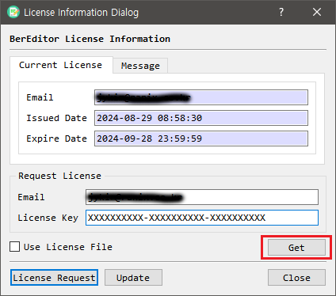

# Get a Free License

BerEditor, CertMan, and CryptokiMan support online issuance of a free, 60-day license. This feature is available in **version 1.8.0 and later**.

You can request another license after the current one expires, including if you have received a license before. The applications are developed as a side project and are not code-signed, because code-signing certificates involve additional costs. As a result, your operating system may show an unknown-developer or security warning. The author states that the applications are not malware; download them only from the official source and make your own security assessment.

The online licensing process has three steps: submit your email address, retrieve the license key from your email, and apply the key in the application.

## 1. Request a license by email

Open the [Get a free license](https://jykim74.mycafe24.com/user_reg.php?lang=en), enter your email address, and select the application for which you need a license.

The license key is sent to the email address you provide. The author states that the email address is used only for license issuance.

## 2. Find the license key in your email

Check your inbox for the license email and copy the license key. If it does not arrive, check your spam or junk folder.

## 3. Apply the license in the application

Open the application's license information screen. Enter the email address used for the request and the license key from the email, then click **Get** (or the equivalent button in your version).

The licensed features will be available for 60 days. After the license expires, you can submit a new request.

- **Email:** The email address you used when requesting the license.
- **License Key:** The key from the license email. Enter it, then click **Get**.
